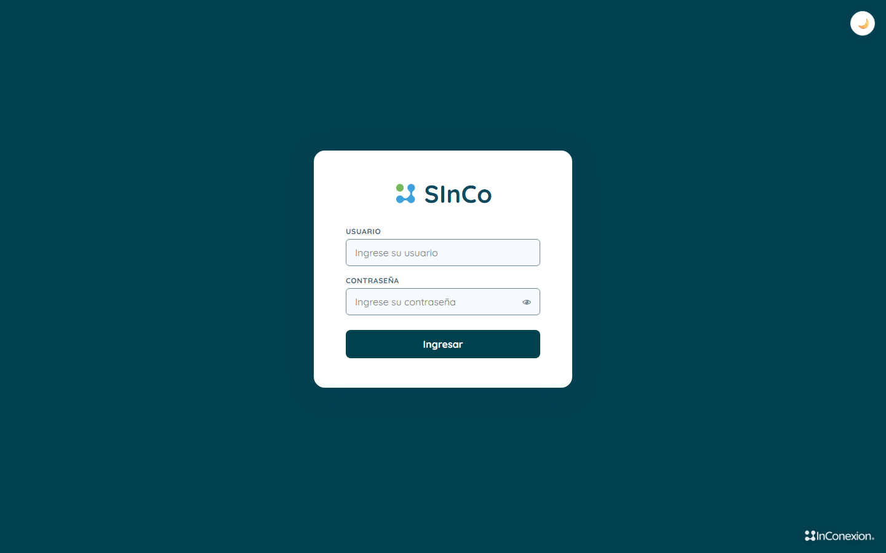
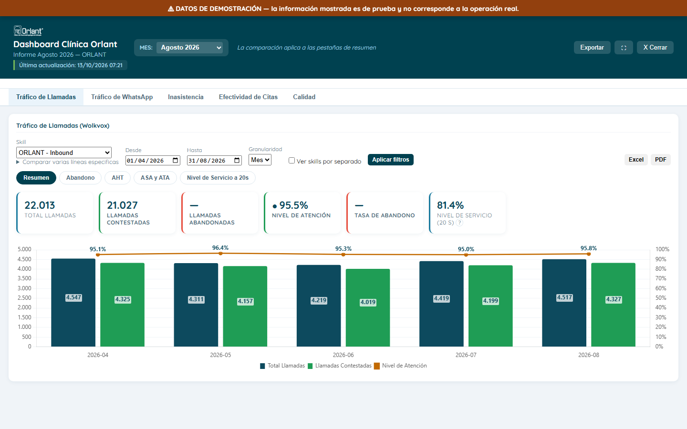
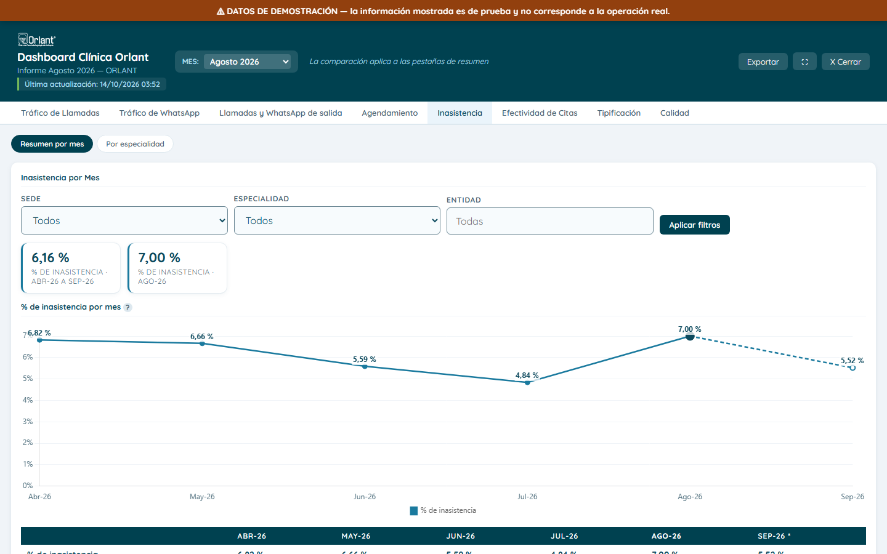
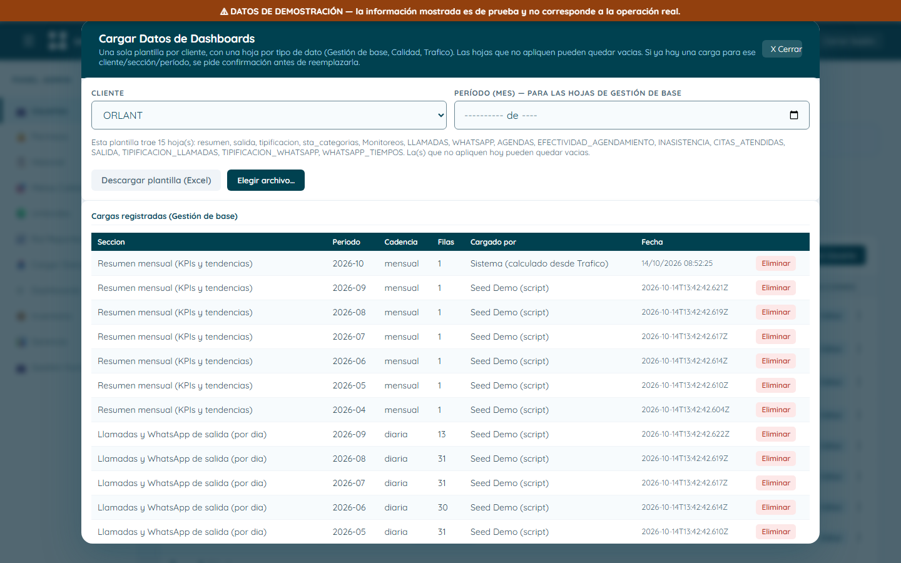
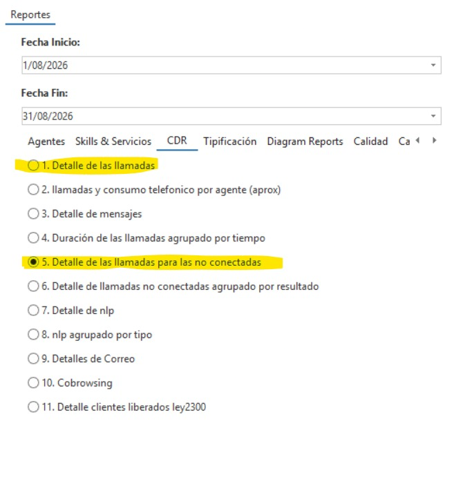
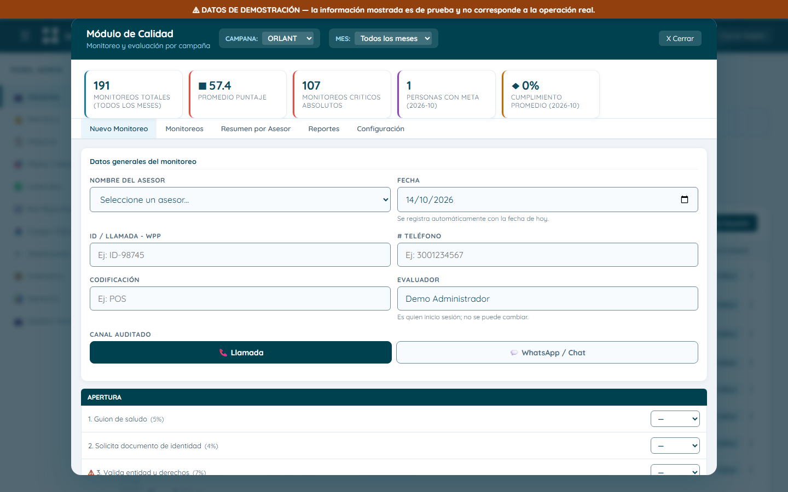
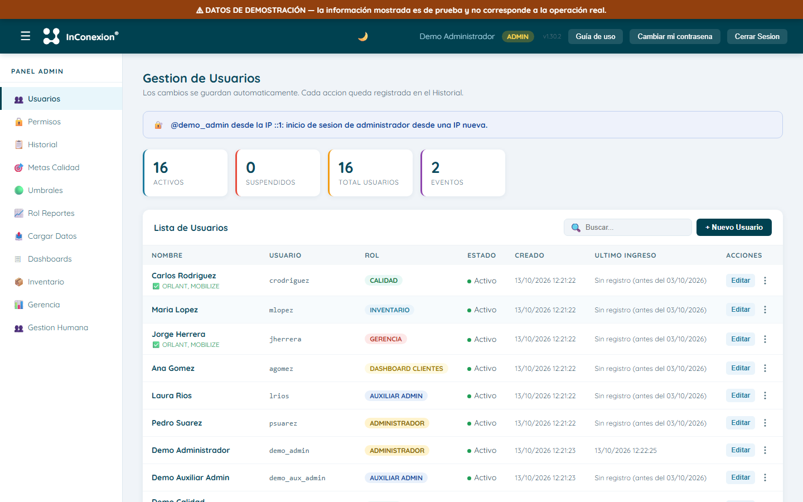

# Guía de uso — SInCo (ORLANT y Mobilize)

> Este archivo es el espejo legible en GitHub de la guía REAL que ve el
> usuario dentro de la plataforma: `server/paginas/guia-uso.html` (servida
> por `GET /guia-uso`, con sesión — ver `server/routes/guia.js`). Mismas 9
> secciones, mismo contenido — al editar una, editar la otra en el mismo
> PR (`scripts/guia/generar-pdf.js` regenera el PDF a partir de la versión
> HTML real, no de este `.md`).

Versión de la plataforma: **1.72.3**. La plataforma se llama **SInCo** (de
InConexion®). Esta guía es para quien usa la
plataforma todos los días (Edwin, Jairo y el equipo) — no tiene nada
técnico, solo explica qué hace cada pantalla y cómo se usa.

> La plataforma tiene datos oficiales desde **agosto de 2026** (más julio
> de Tipificación de WhatsApp, que sí es real). Los datos de meses
> anteriores que venían en las plantillas de prueba ya se quitaron. Octubre
> llega por partes, a medida que se cargan sus archivos.

## Índice

1. [Cómo entrar](#1-cómo-entrar)
2. [El dashboard de ORLANT](#2-el-dashboard-de-orlant)
3. [Qué significa cada indicador](#3-qué-significa-cada-indicador)
4. [Cómo cargar cada base cada mes](#4-cómo-cargar-cada-base-cada-mes)
5. [Calendario mensual](#5-calendario-mensual)
6. [Calidad](#6-calidad)
7. [Usuarios y permisos (solo administrador)](#7-usuarios-y-permisos-solo-administrador)
8. [Pendiente de datos](#8-pendiente-de-datos)
9. [A quién escribir si algo falla](#9-a-quién-escribir-si-algo-falla)

---

## 1. Cómo entrar

La plataforma (SInCo) vive en **https://sinco.inconexion.com.co**. Ábrela en el
navegador (Chrome, Edge o similar) como cualquier página web.

La pantalla de inicio muestra, dentro de la tarjeta, el logo de InConexion®
a la izquierda de **SInCo**, en la misma línea (a color en tema claro,
blanco en tema oscuro), y otro logo pequeño en la esquina inferior derecha. Escribe tu **usuario** y
tu **contraseña**, y presiona "Ingresar". Cada persona tiene su propio usuario, con
acceso solo a lo que le corresponde (ver [sección 7](#7-usuarios-y-permisos-solo-administrador)).

**Si olvidaste la contraseña**: hoy la plataforma no tiene un botón de
"recuperar contraseña" — tienes que pedirle a un administrador que te
la cambie desde la pantalla de Usuarios (Administración → Usuarios → tu
usuario → "Cambiar contraseña"). Avísale por el canal que usen
normalmente (no la escribas en un mensaje que quede guardado, para que
solo tú la conozcas).

**Cómo cambiar mi contraseña:** si ya la sabes y quieres cambiarla tú
mismo (sin pedírselo a un administrador), entra a la plataforma y en el
menú de tu usuario (arriba a la derecha) elige **"Cambiar mi
contraseña"**. Te va a pedir la contraseña actual, la nueva y que la
confirmes. Al cambiarla, cualquier otra sesión que tuvieras abierta (otro
equipo, otra pestaña) deja de funcionar — la pantalla donde la cambiaste
sigue abierta, sin que tengas que volver a entrar.

**Demasiados intentos**: si te equivocas de contraseña muchas veces, la
plataforma te pide esperar unos minutos antes de volver a intentar (el
mensaje dice cuántos). Además, si una misma cuenta acumula 30 intentos
fallidos en una hora (aunque sean desde computadores distintos), queda
bloqueada para iniciar sesión hasta que pase esa hora (salvo la cuenta del
administrador principal, que solo tiene el límite por computador), y el administrador
ve el aviso "Cuenta bloqueada por intentos" en el Historial.

## 2. El dashboard de ORLANT

Al entrar, elige el dashboard de **ORLANT** en el menú principal. Arriba
del todo vas a ver:

- El **selector de MES** — elige el mes que quieres ver, con su nombre
  completo (ej. "Septiembre 2026"). Mueve las tarjetas y gráficas de todas
  las pestañas a ese mes a la vez. A veces un mes aparece como **parcial**
  (ej. "Julio 2026" solo con datos de Tipificación de WhatsApp) — es normal
  y esperado cuando a ese mes solo le llegó una parte de los datos, no es
  un error. En la lista salen todos los meses que tienen algún dato, aunque
  sea de una sola base (por ejemplo, un mes que solo tiene WhatsApp por
  rangos o el Resumen de calidad).
- El filtro **MESES** — para ver varios meses sueltos lado a lado (por
  ejemplo, solo septiembre y octubre, sin agosto). Marca los meses que
  quieras: las gráficas y tablas que van por mes muestran solo esos meses.
  No suma meses: las tarjetas siguen el selector de MES. "Ver todos los
  meses" lo deja como estaba.
- El botón **Exportar** — descarga a Excel todo lo que estás viendo en la
  pestaña activa (una hoja por gráfica/tabla).
- El botón de **pantalla completa** — agranda el dashboard para que ocupe
  toda la pantalla (útil al compartir pantalla en una reunión); un
  segundo clic (o la tecla Esc) vuelve a la vista normal.
- El interruptor de **tema oscuro/claro** (en el menú de tu usuario,
  arriba a la derecha) — cambia el color de toda la plataforma, no afecta
  los datos.
- **En el celular** (y en tablet): el encabezado es compacto. Los filtros
  MES, MESES y COMPARAR quedan guardados en un botón que dice el mes
  elegido (por ejemplo "Sep 2026"); al tocarlo se abren y al elegir un mes
  se cierran solos. La fecha de la última actualización sale corta
  ("Act. 24/10 08:30") y Actualizar/Exportar se muestran solo con su
  icono. Las pantallas de Llamadas y WhatsApp que van lado a lado en el
  computador quedan una debajo de la otra.

El tablero de **Mobilize** funciona igual y tiene 5 pestañas: Flujo de
Llamadas (con Nivel de Servicio, Abandono, ASA y ATA, AHT y One & Done),
Llamadas Únicas y de Salida, Tipificación, Encuesta y Calidad (que empieza
con el Resumen de calidad por asesor).

### Las 8 pestañas

| Pestaña | Qué muestra |
|---|---|
| **Tráfico de Llamadas** | Volumen de llamadas, nivel de servicio y estado (contestadas/abandonadas) del mes, con 5 sub-pestañas: Flujo de Llamadas, Abandono, AHT, ASA y ATA, Nivel de Servicio a 20s. |
| **Tráfico de WhatsApp** | Lo mismo que Llamadas, pero para los chats de WhatsApp, con 4 sub-pestañas: Flujo de WhatsApp, Abandono, ASA y ATA, Nivel de Servicio (en Orlant: el porcentaje de conversaciones contestadas en cada rango de tiempo — 0-3, 3-5, 5-8, 8-10 y más de 10 minutos — de un mes, con filtro de Mes y de Cola; por defecto el mes elegido arriba, o el último con datos). No tiene sub-pestaña de AHT — Wolkvox no entrega ese dato para WhatsApp. |
| **Agendamiento** | Citas agendadas, con 4 vistas: Por especialidad, Total agendas, Agendas por línea, Ranking de asesores (por EFECTIVIDAD de agendamiento). |
| **Inasistencia** | El % de inasistencia, por mes y por especialidad, con filtros de sede/especialidad/entidad — ver el detalle en la [sección 3](#3-qué-significa-cada-indicador). |
| **Efectividad de Citas** | El % de citas agendadas que realmente se atendieron, por mes — ver el detalle en la [sección 3](#3-qué-significa-cada-indicador). |
| **Tipificación** | Cómo se clasificó cada llamada/chat (motivo de contacto), con Llamadas y WhatsApp lado a lado y las tarjetas de llamadas de salida (conectadas y no conectadas). |
| **Llamadas y WhatsApp de salida** | Llamadas y WhatsApp de SALIDA (no de entrada), por mes y por línea (3P/General). En los meses con CDR sale del CDR, repartido por la línea de cada asesor — ver el detalle en la [sección 3](#3-qué-significa-cada-indicador). |
| **Calidad** | Monitoreo de calidad de los asesores, con su nota y resultados. |

Cada pestaña que tiene varias vistas las muestra como **sub-pestañas**
justo debajo del nombre de la pestaña principal — haz clic para cambiar
entre ellas, sin perder el mes ni los filtros que ya elegiste.

*(En este entorno de demostración no todas las bases tienen datos de
ejemplo cargados — Agendamiento y Tipificación solo aparecen cuando su
base sí está cargada, tanto en demo como en producción real.)*

### Filtros

La mayoría de las pestañas traen filtros propios arriba de sus gráficas
(especialidad, línea, rango de meses, etc.) con un botón **"Aplicar
filtros"**. Elige lo que quieras ver y presiona ese botón — las gráficas
de esa sub-pestaña se vuelven a dibujar con el filtro puesto.

Si un mes todavía no tiene datos cargados para esa pestaña, sale un aviso
explicando que no hay datos para ese mes (y un botón para ir directo al
último mes que sí tiene).

## 3. Qué significa cada indicador

**Tráfico de Llamadas**

- **Total**: todas las llamadas que entraron en el mes.
- **Contestadas**: las que un asesor sí atendió.
- **Abandonadas**: las que colgaron antes de que las atendieran.
- **Nivel de atención**: contestadas ÷ total, en %.
- **% de abandono**: abandonadas ÷ total, en %.
- **Nivel de servicio a 20 segundos**: de TODO lo que entró (no solo lo
  contestado), qué % se contestó en 20 segundos o menos. Cuando se
  combinan varias líneas o meses, se promedia **ponderado por el total de
  llamadas de cada uno** (no es un promedio simple de los porcentajes).
- **AHT** (tiempo promedio de atención): cuánto dura en promedio una
  llamada YA contestada. Se promedia ponderado por las **llamadas
  contestadas** (una llamada abandonada nunca tuvo un AHT, así que no
  cuenta en ese promedio).

**Tráfico de WhatsApp**: los mismos indicadores que Llamadas, con el
Nivel de Servicio a 20 segundos, **excepto el AHT**: Wolkvox no entrega
ese dato para WhatsApp, así que esa sub-pestaña no aparece. Wolkvox
tampoco entrega todavía el Nivel de Servicio a 5 minutos (la ventana de
tiempo que más le importa a WhatsApp) — cuando llegue ese dato, se puede
activar sin tocar nada más de la plataforma.

**Agendamiento**: "Por especialidad", "Total agendas" y "Agendas por
línea" muestran cuántas citas se agendaron, sin un cálculo adicional —
son conteos directos agrupados de distinta forma. La 4ª vista, **Ranking
de asesores**, es distinta: ordena a los asesores por **% de EFECTIVIDAD
de agendamiento = agendas ÷ gestiones** (nunca por cantidad de agendas) —
un asesor con pocas gestiones pero casi todas agendadas puede quedar por
encima de uno con muchas más gestiones pero menos agendadas. La
tarjeta "Efectividad del equipo" es la **suma de todas las agendas ÷ suma
de todas las gestiones** (ponderada) — nunca el promedio simple de los %
de cada asesor, que da un número distinto (y menos correcto, porque le da
el mismo peso a un asesor con 50 gestiones que a uno con 2.000).

Tanto la tabla de **Agendas** como el **Ranking de Efectividad de
Agendamiento** muestran el **nombre real del asesor** — lo ve cualquier
usuario con acceso al dashboard de ORLANT (ver [sección 7](#7-usuarios-y-permisos-solo-administrador)
para quién tiene acceso a qué). Es normal ver algún asesor por encima del
100% de efectividad (agenda más de lo que cuentan sus gestiones
registradas) — no es un error de carga; queda pendiente aclarar si hay
agendas que se originan por fuera de las gestiones que se están
contando.

**Inasistencia**: el % de inasistencia es **(inasistencia + pendientes) ÷
total, ponderado**. Los "pendientes" (citas que quedaron sin confirmar si
la persona fue o no) cuentan como inasistencia para este cálculo; las
canceladas NO cuentan como inasistencia, pero sí quedan en el total. Al
combinar varias especialidades, el % se calcula sobre la SUMA de todas
(nunca promediando los % de cada especialidad por separado — eso daría
un número distinto y menos correcto). Tiene filtros de Sede, Especialidad
y Entidad (esta última con buscador, porque son muchas) y 2 vistas:

- **Resumen por mes** (la que abre por defecto): 2 tarjetas (el % de todo
  el período que deja pasar los filtros de arriba, y el % del mes elegido
  arriba — cada una dice su propio rango, para no confundirlas) más una
  gráfica de línea con el valor de cada mes, una tabla de datos debajo
  (mes y % alineados, más el total de citas) y un aviso cuando un mes
  trae menos datos que el resto — el mes elegido arriba se resalta (punto
  más grande, columna en negrita en la tabla); un mes que todavía viene
  del formato de reporte anterior (sin sede ni entidad) se marca con un
  punto hueco, el último tramo de la línea punteado y un asterisco en la
  tabla.
- **Por especialidad**: una barra por especialidad, del mes elegido
  arriba. Las especialidades con muy pocas citas ese mes se marcan con
  un asterisco (\*) y se muestran al final — su % puede no ser
  representativo.

**Efectividad de Citas**: el % de **EFECTIVIDAD = citas atendidas ÷
agendas**, un total del mes (no por especialidad ni asesor). Muestra 2
tarjetas: el % del mes elegido arriba, y el % **ponderado** de todo el
período que tiene datos cargados (suma de atendidas ÷ suma de agendas de
esos meses — nunca el promedio simple de los % de cada mes), con el rango
de meses en su etiqueta. Hoy esta pestaña tiene Agosto y Septiembre 2026
— igual que el resto de la plataforma, solo los meses oficiales.

**Llamadas y WhatsApp de salida**: el total del mes de llamadas y WhatsApp de **salida** (que la
campaña hace hacia afuera, no las que recibe), separado por línea 3P y
Línea General. Muestra 2 tarjetas (total de llamadas y total de WhatsApp
del mes elegido, con la variación contra el mes anterior cuando hay con
qué comparar) y 2 gráficas de barras (una para llamadas, otra para
WhatsApp) — con pocos meses de historia, una gráfica de barras por mes se
lee mejor que una línea de tendencia. La tabla de abajo también muestra
qué porcentaje de cada mes fue 3P vs. Línea General (participación DENTRO
de ese mismo mes — no hay todavía un indicador de salida contra el total
de gestión, por eso no aparece aquí).

**De dónde sale cada mes (desde octubre de 2026)**: en los meses que ya
tienen los CDR de Wolkvox cargados (Tipificación), la salida se cuenta del
CDR: cada registro de llamada de salida y cada WhatsApp de salida, por
asesor. Cada asesor se asigna a la línea **3P** o **General** en cada mes
(solo el administrador, en la misma pestaña, "Línea de cada asesor", con
"Copiar del mes anterior"); un asesor sin línea suma en **"Sin asignar"**
y la pestaña lo avisa. Los meses sin CDR siguen con el archivo mensual de
Edwin. La tabla dice de dónde salió cada mes ("Fuente").

**Tipificación**: conteo de cuántas llamadas/chats quedaron marcados con
cada motivo de contacto, sin cálculo adicional. El nombre del asesor
también aparece aquí (ya era así desde antes). La tipificación de
llamadas y la de WhatsApp van lado a lado en computador (una debajo de la
otra en el celular), cada una con su torta y sus filtros de asesor, skill
y tipo (entrante o de salida); el mes es el mismo para las dos. Las
tarjetas de llamadas de salida van en la mitad de llamadas.

Reglas de las tarjetas de salida (confirmadas por Edwin el 23/10/2026):
una llamada es **de salida** si en el CDR su tipo (TYPE_INTERACTION) es
`outbound_ma` u `out_pre` (marcador predictivo), aunque traiga un skill
de entrada; las llamadas internas (`internalcall`) no cuentan. En ORLANT,
**no conectada** = tipificación NO_CONTESTAN o BUZON (en Mobilize,
Cliente_no_contesta); el resto son conectadas. Se cuenta cada registro,
no el teléfono único.

**Salida General y Salida 3P (ORLANT, desde la v1.75.0)**: la salida de
llamadas (skill "-") y la de WhatsApp (SKILL_ID 0) se reparten según el
asesor que la hizo. Cada mitad muestra las tarjetas "Salida General",
"Salida 3P" y, si hay asesores sin línea, "Sin clasificar", más una torta
de salida por línea; las tres suman la salida del canal y el total del mes
no cambia. El filtro **"Línea de salida"** (junto al mes) deja en las dos
tortas de tipificación solo la salida de esa línea. El administrador elige
la línea de cada asesor con el botón **"Clasificación de asesores"**: una
ventana con los asesores de los CDR cargados y un selector por cada uno
(Sin clasificar, Línea General o Línea 3P). Se guarda una sola vez por
cliente, para todos los meses. También se puede llenar desde un Excel con
dos columnas, el nombre del asesor y la línea ("General" o "3P"): los
nombres se comparan sin importar mayúsculas, tildes ni espacios de más; un
nombre que no coincide con ningún asesor de los CDR se avisa y no se
aplica. Los usuarios del cliente ven las tarjetas y las tortas, pero no el
botón. Es aparte de la línea por mes de la pestaña "Llamadas y WhatsApp de
salida", que no cambia.

**Calidad**: cada monitoreo responde una lista de preguntas con peso
propio (SI / NO / N/A). Un SI o un N/A suma el peso completo de esa
pregunta; un NO en una pregunta normal no suma nada; un NO en una
pregunta **crítica** resta puntos adicionales y cuenta como un "fallo". El
puntaje final queda entre 0 y 100, y se clasifica así:

| Puntaje | Clasificación |
|---|---|
| Menos de 70 | 🔴 Crítico |
| 70 a 89 | 🟡 No crítico |
| 90 a 100 | 🟢 Sobresaliente |

## 4. Cómo cargar cada base cada mes

Todas las cargas se hacen desde **"Cargar Datos"** (menú principal),
eligiendo el cliente **ORLANT** y descargando primero la **plantilla
consolidada** (un solo Excel con una hoja por base). Llena la hoja que te
toque con el archivo que te llegue, sin cambiar los nombres de las
columnas, y vuelve a subir ese mismo Excel.

Al subir, la plataforma te muestra **antes de guardar** cuántas filas se
van a reemplazar (para que nunca subas un mes por error sin darte
cuenta), y después de guardar te confirma cuántas filas se cargaron.
Si algo no cuadra (falta una columna obligatoria, un dato inválido, una
fecha futura), sale un **aviso explicando exactamente qué fila y qué
columna** tiene el problema — esa fila se omite, pero el resto del
archivo sí se carga.

**Centro de cargas** (Cargar Datos → cliente → una tarjeta por base → los
meses del año): cada mes muestra cuántos registros tiene. Desde ahí se
**sube o reemplaza** un mes (solo entran las filas de ese mes), se
**descarga lo cargado** o la **plantilla**, se **elimina** un mes y, si
fue un error, se **deshace** (la base anterior se guarda 30 días, en
"Versiones guardadas"). Todo queda en el Historial. Después de subir,
eliminar o deshacer, el tablero que esté abierto se actualiza solo, sin
recargar la página, y se queda en el mismo mes y la misma pestaña. El
botón "Actualizar datos" del tablero abre el Centro en la base de la
pestaña que estás viendo.

### Tráfico de Llamadas

- **Qué archivo**: el reporte diario de llamadas por skill, que exporta
  Wolkvox.
- **Hoja**: `LLAMADAS` de la plantilla.
- **Columnas obligatorias**: SKILL_NAME, DATE, TOTAL LLAMADAS, LLAMADAS
  CONTESTADAS. Las demás (abandonadas, niveles de servicio, ASA, ATA,
  AHT, etc.) son opcionales — si no vienen, esa gráfica queda sin ese
  dato, pero el resto carga igual.
- **Reemplazo**: al subir, se reemplazan las filas de esa(s) skill(s) en
  las fechas que trae el archivo — nunca las de otras skills o fechas que
  no vengan en el archivo.

### Tráfico de WhatsApp

- **Qué archivo**: el reporte de WhatsApp por cola, de Wolkvox.
- **Hoja**: `WHATSAPP`.
- **Columnas obligatorias**: NOMBRE_COLA_WHATSAPP, FECHA INICIO, FECHA
  FIN, TOTAL WHATSAPP, WHATSAPP CONTESTADOS. Aquí el periodo se reporta
  como un RANGO de fechas (FECHA INICIO — FECHA FIN), no un solo día.
- **Reemplazo**: mismo criterio que Llamadas, pero por el rango de fechas
  que trae cada fila.

### Tipificación

- **Qué archivos**: los dos CDR de Wolkvox, uno de llamadas y uno de
  WhatsApp. Se cargan por separado: cada uno reemplaza solo su canal y
  solo las fechas que trae (si el CDR de septiembre trae unas filas del
  31 de agosto, la vista previa lo dice; el resto de agosto no se toca).
- **Llamadas** — CDR de llamadas, export completo (hoja "HistCDR…").
  Dónde se descarga: [ruta pendiente de confirmar con Edwin]. Las filas
  con SKILL_ID/SKILL_NAME "-" y tipo `outbound_ma` u `out_pre` son
  **Llamadas de salida**; una fila `out_pre` cuenta como salida aunque
  traiga skill (en ORLANT, 4070 CANCELACIONES Y REPROGRAMACION). Las
  internalcall no cuentan como salida.
- **WhatsApp** — CDR de WhatsApp, export **"HistChat"** (hoja
  "HistChat…", cambia de nombre cada vez; **no hace falta renombrarla**).
  Dónde se descarga: [ruta pendiente de confirmar con Edwin]. Trae el
  **número** del skill (SKILL_ID), no su nombre: la plataforma lo traduce
  con la tabla de skills de WhatsApp del cliente. El 0 es **WhatsApp de
  salida**; un número que no esté en la tabla se ignora y la vista previa
  dice cuántos. Un administrador edita la tabla en Cargar Datos →
  "Skills de WhatsApp". Tabla de ORLANT:

  | SKILL_ID | Skill |
  |---|---|
  | 0 | WHATSAPP DE SALIDA (salida) |
  | 4042 | WHATSAPP PAUTAS |
  | 4047 | WHATSAPP AUDIFONOS |
  | 4061 | WHATSAPP FONOAUDIOLOGIA |
  | 4071 | WHATSAPP FONIATRIA |
  | 4306 | WHATSAPP 3P |
  | 4327 | WHATSAPP GENERAL |
  | 4338 | WHATSAPP CONFIRMACIONES |
  | 4362 | ATENCION TUTELAS |

- **Privacidad**: los dos archivos traen datos de contacto del paciente
  (nombre, correo, teléfono, comentarios): la plataforma **nunca los lee
  ni los guarda** — solo toma el asesor, la fecha, el skill y el motivo
  de contacto.
- **Límite de tamaño por carga**: una carga mensual normal cabe sin
  problema; si el archivo junta muchos meses de una sola vez y es muy
  grande, la plataforma avisa ANTES de intentar guardar nada — en ese
  caso, sube el archivo por meses, uno a la vez.

### Agendas

- **Qué archivo**: el reporte de citas agendadas, del sistema de
  agendamiento de ORLANT.
- **Hoja**: `AGENDAS`.
- **Columnas obligatorias**: NOMBRE DE AGENTE, SEDE, NOMBRE_EXAMEN,
  ESPECIALIDAD, PROFESIONAL, FECHA_SOLICITUD, TIPO DE LINEA.
- **Reemplazo**: por el RANGO continuo de fechas que trae el archivo (no
  por mes) — si el archivo trae del 1 al 15, solo se reemplaza ese
  tramo.
- **Límite de tamaño por carga**: igual que Tipificación — una carga
  mensual normal cabe sin problema; si el archivo junta varios meses de
  una sola vez y es muy grande, la plataforma avisa ANTES de intentar
  guardar nada. Sube el archivo por meses, uno a la vez.

### Alias de nombre de asesor

Cuando el mismo asesor queda escrito de 2 formas distintas en los
archivos (ej. con y sin tilde, o con un apellido distinto) en Agendas,
Efectividad de Agendamiento o Tipificación, la plataforma puede
**unificarlos bajo un solo nombre** para que el Ranking y los reportes no
los cuenten como 2 personas diferentes — eso es un "alias". Hoy esto
todavía no tiene una pantalla propia (solo lo puede crear o borrar un
administrador); si ves un asesor duplicado en el Ranking, avísale a InCo
para que agregue el alias. **Importante**: borrar un alias NO separa de
nuevo los datos que ya quedaron unificados — esos registros ya guardados
siguen contando como una sola persona para siempre; borrar el alias solo
evita que las cargas futuras se unifiquen de la misma forma.

### Efectividad de Agendamiento (Ranking de asesores)

- **Qué archivo**: el resumen mensual de gestiones/agendas por asesor, de
  Edwin — una fila por asesor, no por cita.
- **Hoja**: `EFECTIVIDAD_AGENDAMIENTO`.
- **Columnas obligatorias**: NOMBRE DE AGENTE, MES, CANTIDAD DE
  GESTIONES, AGENDAS. La columna EFECTIVIDAD del archivo (si viene) nunca
  se guarda — la plataforma siempre la vuelve a calcular; si el número
  del archivo no coincide con el recalculado, sale una advertencia en la
  confirmación (no bloquea la carga).
- **Reemplazo**: por MES — si el archivo trae Septiembre, se reemplaza
  ese mes completo para todos los asesores que traiga, sin tocar otros
  meses ya cargados.

### Inasistencia

- **Qué archivo**: el export de citas del sistema de agendamiento de
  Edwin — una fila por CITA (no un resumen), puede traer varios meses a
  la vez.
- **Hoja**: `INASISTENCIA`.
- **Columnas obligatorias**: SEDE, ESPECIALIDAD, FECHA_CITA, NOMBRE
  ENTIDAD, CITEST.
- **CITEST**: una letra por cita — `C` = Cancelada, `I` = Inasistencia,
  `P` = Pendiente (sin confirmar si la persona fue o no), `T` =
  Atendida. Una letra distinta de estas 4 (o vacía) se avisa; si son
  demasiadas filas así, la carga se rechaza completa.
- El sistema agrupa las filas por sede/especialidad/entidad/mes en el
  navegador antes de guardar — no borres ni resumas filas repetidas: sin
  un número de cita, dos filas idénticas son dos citas reales.
- **Privacidad**: cualquier entidad (NOMBRE ENTIDAD) que aparezca muy
  pocas veces en el archivo se guarda como "PARTICULAR / OTRA" — nunca
  se muestra ni se guarda el valor original.
- **Reemplazo**: por MES — si el archivo trae Agosto y Septiembre, se
  reemplazan esos 2 meses completos, sin tocar ningún otro mes ya
  cargado.
- Septiembre (o el mes que esté en curso) puede traer menos
  especialidades que un mes ya cerrado — es normal, la plataforma avisa
  cuando eso pasa (ver [sección 3](#3-qué-significa-cada-indicador)).

### Efectividad de Citas Atendidas

- **Qué archivo**: el total mensual de agendas/atendidas de Edwin — un
  total del mes, no una fila por cita ni por asesor.
- **Hoja**: `CITAS_ATENDIDAS`.
- **Columnas obligatorias**: MES, AGENDAS, ATENDIDAS. La columna
  EFECTIVIDAD CITAS ATENDIDAS del archivo (si viene) nunca se guarda —
  siempre se recalcula.
- **Reemplazo**: por MES — si el archivo trae Enero, Febrero y Marzo, se
  reemplazan esos 3 meses completos, sin tocar ningún otro mes ya
  cargado.

### Llamadas y WhatsApp de salida

- **Qué archivo**: el consolidado mensual de llamadas y WhatsApp de
  SALIDA de Edwin — un total del mes, no una fila por llamada/chat.
- **Hoja**: cualquier nombre (la plataforma la reconoce por sus
  columnas) — el archivo real de Edwin trae una sola hoja llamada
  "Hoja1", con el encabezado en la fila 3 (2 filas vacías antes).
- **Columnas obligatorias**: MES, LINEA 3P, LINEA GENERAL, WHATSAPP 3P,
  WHATSAPP GENERAL.
- **El mes no trae año** (igual que Efectividad de Agendamiento/Citas):
  antes de guardar, la plataforma muestra a qué año resolvió cada mes
  (ej. "AGOSTO → Agosto 2026") y pregunta si es correcto — si no lo es,
  pide el año correcto y vuelve a intentarlo. Nunca lo adivina en
  silencio.
- **Reemplazo**: por MES — si el archivo trae Agosto y Septiembre, se
  reemplazan esos 2 meses completos, sin tocar ningún otro mes ya
  cargado.
- **Meses con CDR** (desde septiembre de 2026): este archivo ya no hace
  falta; la salida sale del CDR de Tipificación. Lo único que hay que hacer
  es asignar la **línea de cada asesor** (3P o General) en la pestaña
  "Llamadas y WhatsApp de salida" → "Línea de cada asesor" (solo el
  administrador): elegir la línea al lado de cada nombre, o "Copiar del
  mes anterior", y "Guardar líneas". Queda en el Historial.

### Calidad

- La carga normal es **un monitoreo a la vez**, desde el formulario (ver
  [sección 6](#6-calidad)) — no es una carga de archivo mensual como las
  demás bases.
- También existe una **carga masiva** desde Excel (3 hojas: "Monitoreos"
  para diligenciar, "Diccionario" con la lista de preguntas de
  referencia, "Resumen por Asesor" de consulta) para cuando hay muchos
  monitoreos para subir de una vez.

### Calidad: resumen por asesor (Mobilize)

- **Dónde se ve**: al inicio de la pestaña Calidad de Mobilize. Tarjetas
  del mes elegido arriba (promedio general ponderado por el número de
  monitoreos, con semáforo; total de monitoreos y de fallos críticos),
  tabla por asesor (clasificación y alerta en colores) y tabla por mes
  (respeta el filtro MESES). Se exporta a Excel y PDF.
- **Qué archivo**: la plantilla de calidad de Edwin, una fila por asesor
  (no sale de Wolkvox: sale de su libro de Monitoreos). Si las columnas
  son fórmulas a ese libro, ábralo junto con la plantilla, deje que
  calcule y guárdela antes de subirla: la plataforma lee los valores ya
  calculados; una celda en error (#REF!) o vacía omite esa fila con un
  solo aviso. Una fila de total o promedio al final ("TOTAL", "Promedio
  general") no es un asesor: se omite y la vista previa lo dice.
- **Columnas**: Nombre del Asesor (puede decir "← Escribir aquí"),
  \# Monitoreos, Prom. Puntaje (%), Clasificación, Alerta Críticos y Total
  Fallos Críticos. Clasificación y Alerta se recalculan siempre con los
  números: puntaje menor que 70 Crítico, menor que 90 No crítico, si no
  Sobresaliente; 0 fallos "Sin fallos críticos", 1 "Alerta", más de 1
  "Crítico frecuente". Si el puntaje viene en fracción (0,85), se lee como
  85 % y se avisa.
- **Reemplazo**: el mes se elige al subir (Centro de cargas → "Calidad:
  resumen por asesor" → el mes) y se reemplaza solo ese mes.

### Flujo de Llamadas (Mobilize)

- **Sub-pestañas**: Flujo de Llamadas, Nivel de Servicio, Abandono, **ASA y
  ATA** (tiempo promedio de respuesta y de abandono, juntos) y **AHT**
  (tiempo promedio de atención, aparte). Cada una trae arriba su número
  del período elegido.
- **ATA sin abandonos**: ATA es el tiempo promedio hasta que la persona
  cuelga sin ser atendida. Si en el período hay datos pero **ninguna llamada
  abandonada** (como septiembre de 2026 en Mobilize), ATA se muestra como
  **0:00** en la tarjeta, en la gráfica y en la exportación (decisión de
  Edwin, 14/10/2026). Si el período no tiene datos, sale el aviso de "sin
  datos" de siempre.

### Llamadas Únicas (Mobilize)

- **Dónde se ve**: en el tablero de Mobilize, pestaña propia **"Llamadas
  Únicas y de Salida"** (justo después de Flujo de Llamadas). Cuenta una sola vez
  cada teléfono por día, así que no coincide con Flujo de Llamadas, que
  cuenta todas las llamadas de la cola.
- **Qué archivo**: el mismo patrón que las demás bases de Wolkvox, pero
  este archivo hay que armarlo a mano combinando 2 reportes distintos de
  Wolkvox (ver más abajo cómo sacarlos) — Edwin es quien hace esa
  combinación antes de subir.
- **Hoja**: `LLAMADAS_UNICAS` de la plantilla oficial
  (`PLANTILLA_LLAMADAS_UNICAS_MOBILIZE.xlsx`, descargable desde "Cargar
  Datos" eligiendo el cliente **Mobilize**).
- **Columnas obligatorias**: AGENT_NAME, DATE, TELEPHONE, SKILL_NAME. **No se
  aceptan filas con `SKILL_NAME = NO CONTESTADAS`**: esas son llamadas de
  salida no conectadas y van en "Llamadas de salida". Si el archivo trae
  alguna, la vista previa lo avisa y esa hoja no se guarda.
- **Privacidad**: TELEPHONE se usa solo un instante, en la computadora de
  quien sube el archivo, para no contar dos veces una misma llamada del
  mismo número el mismo día — nunca llega al servidor, nunca se guarda,
  nunca se exporta ni se muestra en ninguna pantalla.
- **Reemplazo**: por MES — si el archivo trae Septiembre, se reemplaza
  ese mes completo.

**Cómo sacar las llamadas únicas desde Wolkvox, paso a paso:**

1. **Contestadas de ingreso**: en Wolkvox, Reportes → pestaña **CDR** →
   reporte **"1. Detalle de las llamadas"**. De ahí se quitan dos cosas
   antes de pegarlas en la plantilla: las llamadas de **salida** (el
   número de teléfono trae un guion) y los **duplicados del mismo número
   el mismo día** (no de todo el mes — si el mismo número llama dos días
   distintos, cuenta en cada uno).
2. **Abandonadas de ingreso**: en Wolkvox, Reportes → **Skills &
   Servicios** → **"2. Detalle llamadas abandonadas"** (skill, teléfono y
   día). Se pegan en la misma hoja con **AGENT_NAME vacío**: una fila sin
   asesor cuenta como abandonada. (Las filas "NO CONTESTADAS" de antes eran
   llamadas de salida, por eso no se aceptan aquí.)
3. **Salientes no conectadas**: en Wolkvox, Reportes → pestaña **CDR** →
   reporte **"5. Detalle de las llamadas para las no conectadas"**. Estas
   llamadas **no van en este archivo**: van en el archivo de "Llamadas de
   salida" (ver abajo).

### WhatsApp tiempos de respuesta (Orlant)

- **Dónde se ve**: Tráfico de WhatsApp → sub-pestaña "Nivel de Servicio":
  qué porcentaje de las conversaciones se contestó en cada rango de
  minutos, en un mes. Debajo, dos tablas con el conteo y el % de cada
  rango: **por cola** (el mes elegido) y **por mes** (la cola elegida).
- **De dónde se descarga**: Wolkvox > Reportes > Skills & Servicios >
  **10. Detalle de llamadas contestadas** (fechas del mes, SKILL = ALL).
  Se sube tal cual, sin fórmulas: la plataforma lee SKILL_NAME, DATE (con
  hora), RESULT y ANSWER_TIME (segundos). CONN_ID, SKILL_ID, ANI y la
  columna TIEMPO, si vienen, se ignoran.
- **Rangos** (los calcula la plataforma con ANSWER_TIME):

  | ANSWER_TIME | Rango |
  |---|---|
  | menos de 180 s | 0 a 3 minutos |
  | menos de 300 s | 3 a 5 minutos |
  | menos de 480 s | 5 a 8 minutos |
  | menos de 600 s | 8 a 10 minutos |
  | 600 s o más | 10 minutos en adelante |

- **Qué se carga**: solo las colas cuyo nombre empieza por WHATSAPP; las
  demás (colas de llamadas) se ignoran y la vista previa dice cuántas
  fueron, igual que las filas vacías que se omitieron. Se sube desde el
  Centro de cargas (Orlant → WhatsApp por rangos de tiempo); cada carga
  reemplaza solo sus propias fechas.

### Llamadas de salida (Mobilize)

- **Filtros (Fase 147)**: cada mitad tiene sus propios filtros. Ingreso:
  Desde, Hasta, Skill y Asesor. Salida: Desde, Hasta, **Tipo** (Conectada /
  No conectada) y Asesor. El archivo de salida no trae un skill real (su
  columna SKILL_ID dice si fue conectada o no), por eso el filtro es por
  Tipo. El filtro y el detalle por **Asesor** los ve también el usuario de
  Mobilize (pedido de Edwin, 14/10/2026).

- **Dónde se ve**: en la misma pestaña "Llamadas Únicas y de Salida", mitad derecha
  (las de ingreso quedan a la izquierda; en el celular, una debajo de la
  otra). Tres tarjetas: Total llamadas de salida, Llamadas de salida no
  conectadas y Llamadas de salida conectadas, una gráfica de barras por
  mes y filtros Desde/Hasta. El equipo de InConexion además ve el filtro
  por asesor y el detalle por asesor y por día; el usuario del cliente no
  ve nombres de asesor.
- **Qué archivo**: dos reportes de Wolkvox en una sola hoja: las
  **conectadas** salen de Reportes → CDR → "1. Detalle de las llamadas"
  (solo las de salida) y las **no conectadas** de Reportes → CDR → "5.
  Detalle de las llamadas para las no conectadas". Columnas: AGENT_NAME,
  DATE, TELEPHONE, DESCRIPTION_COD_ACT (la tipificación) y **TIPO**
  ("Conectada" o "No conectada"; también se acepta con guion, guion bajo,
  en plural o la columna SKILL_ID de antes, con "LLAMADAS DE SALIDA
  CONECTADAS/NO CONECTADAS"). Se sube desde el Centro de cargas (Mobilize →
  Llamadas Únicas y de Salida → "De salida" → el mes).
- **Cómo cuenta**: **cada fila es una llamada** (desde octubre de 2026 ya
  no se quitan repetidos del mismo teléfono y día). Una fila sin
  AGENT_NAME se carga como **"Sin asesor"**; solo se omiten las filas
  vacías o sin fecha/tipo, con un aviso agrupado. Días sin llamadas de
  salida son normales: no sale el aviso de "mes incompleto".
- **Privacidad**: igual que en Llamadas Únicas, TELEPHONE nunca llega al
  servidor.
- **Reemplazo**: se reemplaza lo que ya exista entre la primera y la
  última fecha del archivo (la plataforma muestra antes cuántos registros
  va a reemplazar). Se pueden cargar varios meses, uno a la vez.

### Encuesta (Mobilize)

- **Dónde se ve**: pestaña "Encuesta" de Mobilize (antes de Calidad). Un
  solo juego de filtros para toda la pestaña: Desde, Hasta, Skill y Asesor.
  Cuatro recuadros, uno por pregunta, con una barra por cada respuesta
  posible (0 a 10, 1 a 5 o Sí/No — aunque tenga 0) y debajo cuántos
  respondieron y cuántos no. Al final, los comentarios con texto (fecha,
  ID de llamada, skill, asesor). El ID de llamada (CONN_ID) sirve para
  buscar la llamada en Wolkvox; también sale en el Excel. El botón "Preguntas de la encuesta" muestra el texto
  completo de las preguntas.
- **Qué archivo**: el export de Wolkvox (Reportes → numeral 4, hoja
  "HistIVR…") con las columnas AGENT_NAME, SKILL_NAME, DATE, Q01, Q02,
  Q03, Q04, VOICE_MESSAGE y, opcional, CONN_ID (si un archivo no lo trae,
  el ID de llamada queda vacío y la vista previa lo avisa). Se sube tal cual desde "Cargar Datos" eligiendo
  Mobilize: el encabezado se encuentra aunque no esté en la fila 1, y la
  hoja de la tabla dinámica se ignora. "-" o "--" = sin respuesta; un valor
  fuera de rango queda como sin respuesta y se avisa.
- **Reemplazo**: se reemplaza lo que ya exista entre la primera y la
  última fecha del archivo (la plataforma muestra antes cuántas encuestas
  va a reemplazar y los conteos por pregunta, y pide confirmar). Así se
  corrige una base: se vuelve a subir. **Suba siempre el mes completo**:
  los días de ese rango que no vengan en el archivo se borran (por
  ejemplo, un archivo con solo el 1 y el 30 de septiembre deja en blanco
  del 2 al 29).
- **Privacidad**: el archivo no trae teléfonos; si alguna vez los trae, la
  plataforma los ignora antes de enviar nada. El filtro y la columna de
  asesor los ve también el usuario de Mobilize.
- **One & Done** (sub-pestaña de Flujo de Llamadas, la última): barras por
  mes con el % de encuestas con la pregunta 3 en "Sí", con la misma base
  que la tarjeta FCR (mismo número). Arriba, la tarjeta del mes del final
  del rango ("Septiembre 2026: 6,7 % (3 de 45 encuestas)"); debajo, las
  respuestas de la pregunta 3 (Sí / No / Sin respuesta). Un mes sin
  encuestas dice "Sin encuestas este mes".
- **FCR en Flujo de Llamadas**: en la sub-pestaña "Flujo de Llamadas" hay
  una tarjeta "Solución en primer contacto (FCR)" = encuestas con la
  pregunta 3 en "Sí" ÷ todas las encuestas del mes (o, si se configura
  `fcrBase: 'respondieron'` en el panel, ÷ las que respondieron la
  pregunta 3). Siempre muestra la cuenta ("3 de 45 encuestas"); el mes es
  el del final del rango Desde/Hasta del panel, y los demás meses del rango
  con encuestas van debajo. Sin encuestas: "Sin encuestas este mes".

### Plantillas nuevas (octubre de 2026): de dónde salen y qué columnas traen

Todas se descargan desde el Centro de cargas ("Descargar plantilla") y
traen una hoja INSTRUCCIONES. Las de Wolkvox se pueden subir **tal cual
salen de Wolkvox**, sin renombrar la hoja ni quitar columnas: la
plataforma solo lee las columnas de la última columna de la tabla y nunca
lee teléfonos, nombres de clientes, correos ni comentarios.

| Plantilla (carga) | De dónde se descarga | Qué columnas trae | Cuáles lee la plataforma |
|---|---|---|---|
| CDR de llamadas (Tipificación → Llamadas) | Wolkvox, CDR de llamadas, export completo (hoja "HistCDR…"). Ruta exacta: pendiente de confirmar con Edwin. | Las 20 del HistCDR, en su orden: AGENT_NAME, DATE, DESTINY, TELEPHONE, COST, TIME_SEC, TIME_MIN, COD_ACT, DESCRIPTION_COD_ACT, COD_ACT_2, DESCRIPTION_COD_ACT_2, TYPE_INTERACTION, CUSTOMER_ID, HUNG_UP, CAMPAIGN_ID, CONN_ID, SKILL_ID, SKILL_NAME, AGENT_ID, COMMENT | Obligatorias: AGENT_NAME, DATE, DESCRIPTION_COD_ACT, SKILL_NAME. Opcionales: TIME_SEC, TIME_MIN, COD_ACT, TYPE_INTERACTION, HUNG_UP, SKILL_ID |
| CDR de WhatsApp (Tipificación → WhatsApp) | Wolkvox, CDR de WhatsApp, export "HistChat" (hoja "HistChat…"). Ruta exacta: pendiente de confirmar con Edwin. | Las 32 del HistChat, entre ellas CONN_ID, CHANNEL, DATE, DATE_CLOSE, AGENT_NAME, DESCRIPTION_COD_ACT, SKILL_ID, CUSTOMER_NAME, CUSTOMER_EMAIL, CUSTOMER_PHONE y COMMENTS | Obligatorias: AGENT_NAME, DATE, DESCRIPTION_COD_ACT y SKILL_ID (que se traduce con la tabla de skills; 0 = salida; uno que no esté queda como "Skill <número>"). Opcionales: CHANNEL y DATE_CLOSE (fecha de cierre: si viene, define el día y el mes de cada chat) |
| WhatsApp por rangos de tiempo (ORLANT) | Wolkvox > Reportes > Skills & Servicios > 10. Detalle de llamadas contestadas (fechas del mes, SKILL = ALL) | SKILL_NAME, DATE, RESULT, ANSWER_TIME y, según el export, CONN_ID, SKILL_ID, ANI y TIEMPO | SKILL_NAME (solo colas WHATSAPP…), DATE con hora, RESULT (solo ANSWER) y ANSWER_TIME en segundos (también como texto, con apóstrofo o hh:mm:ss) |
| Llamadas de salida (Mobilize) | Wolkvox > Reportes > CDR: "1. Detalle de las llamadas" (conectadas, solo salida) + "5. Detalle de las llamadas para las no conectadas" | AGENT_NAME, DATE, TELEPHONE, DESCRIPTION_COD_ACT, TIPO | Las 5 (TELEPHONE solo en el navegador, nunca se envía) |
| Llamadas Únicas de ingreso (Mobilize) | Wolkvox > Reportes > CDR: "1. Detalle de las llamadas" (contestadas) + Skills & Servicios: "2. Detalle llamadas abandonadas" | AGENT_NAME, DATE, TELEPHONE, SKILL_NAME | Las 4 (TELEPHONE solo en el navegador; AGENT_NAME vacío = abandonada) |
| Calidad: resumen por asesor (Mobilize) | No es de Wolkvox: la plantilla de Edwin, calculada desde su libro de Monitoreos | Nombre del Asesor, # Monitoreos, Prom. Puntaje (%), Clasificación, Alerta Críticos, Total Fallos Críticos | Nombre, # Monitoreos, Puntaje y Fallos (Clasificación y Alerta se recalculan) |

## 5. Calendario mensual

| Base | Quién la manda | De qué sistema sale | Cuándo se carga |
|---|---|---|---|
| Tráfico de Llamadas | Edwin | Wolkvox | **Pendiente de confirmar con Edwin** |
| Tráfico de WhatsApp | Edwin | Wolkvox | **Pendiente de confirmar con Edwin** |
| Tipificación | Edwin | Wolkvox | **Pendiente de confirmar con Edwin** |
| Agendas | Edwin | Sistema de agendamiento ORLANT | **Pendiente de confirmar con Edwin** |
| Efectividad de Agendamiento | Edwin | Resumen propio de ORLANT | Mensual, después de cerrado el mes |
| Inasistencia | Edwin | Sistema de agendamiento ORLANT | Mensual, después de cerrado el mes |
| Efectividad de Citas Atendidas | Edwin | Resumen propio de ORLANT | Mensual, después de cerrado el mes |
| Llamadas y WhatsApp de salida | Edwin | Resumen propio de ORLANT | Mensual, después de cerrado el mes |
| Calidad | El equipo de Calidad | Monitoreos propios | Continuo, a medida que se hacen |
| WhatsApp por rangos de tiempo (ORLANT) | Edwin | Wolkvox | **Pendiente de confirmar con Edwin** |
| Llamadas de salida y Únicas (Mobilize) | Edwin | Wolkvox | **Pendiente de confirmar con Edwin** |
| Calidad: resumen por asesor (Mobilize) | Edwin | Libro de Monitoreos de Edwin | Mensual |

*(Las filas en negrita son las que todavía no tienen una frecuencia
confirmada — quedan pendientes de que Edwin la precise; el resto ya se
confirmó con él.)*

## 6. Calidad

- **Crear un monitoreo**: Calidad → "Nuevo monitoreo". La fecha y el
  evaluador se ponen solos (hoy y quien inició sesión) y no se pueden
  cambiar a mano, para que el registro sea confiable. Completa el
  formulario con las respuestas (SI/NO/N/A) y guarda.

  
- **Cargar la lista de codificaciones**: Calidad → pestaña de
  configuración/catálogo — ahí se sube la lista de codificaciones válidas
  por campaña (la manda Edwin).
- **Alerta al asesor**: cuando a un asesor le registran un monitoreo
  nuevo, la próxima vez que inicia sesión le sale un aviso con un botón
  para verlo.
- **"Mis Resultados"**: cada asesor, al iniciar sesión con su propio
  usuario, tiene una pantalla donde ve sus propios monitoreos y su nota —
  no ve los de otros asesores.

## 7. Usuarios y permisos (solo administrador)

Desde **Administración → Usuarios** (solo visible si tu usuario es
administrador):

1. "Nuevo usuario" → escribe nombre, usuario, contraseña (mínimo los
   caracteres que pida el formulario) y elige el rol.
2. Marca las **campañas** a las que ese usuario va a tener acceso (ej.
   solo ORLANT) — así esa persona nunca ve datos de otra campaña.
3. Guarda. Esa persona ya puede iniciar sesión con lo que le diste.

Para cambiarle la contraseña o los permisos después, entra a ese usuario
desde la misma lista y edítalo.

## 8. Pendiente de datos

Esto no es un problema de la plataforma — son datos que todavía faltan
por llegar:

- **Nivel de servicio de WhatsApp a 5 minutos**: falta que el reporte de
  Wolkvox traiga esa columna.
- **Ordenamiento Médico, Recuperación de Cancelados, Flujo Mensual,
  Gestión STA**: las pantallas ya están construidas, quedan ocultas
  hasta que llegue el archivo real de cada una.

## 9. A quién escribir si algo falla

Jose David Osorio — (completar).
